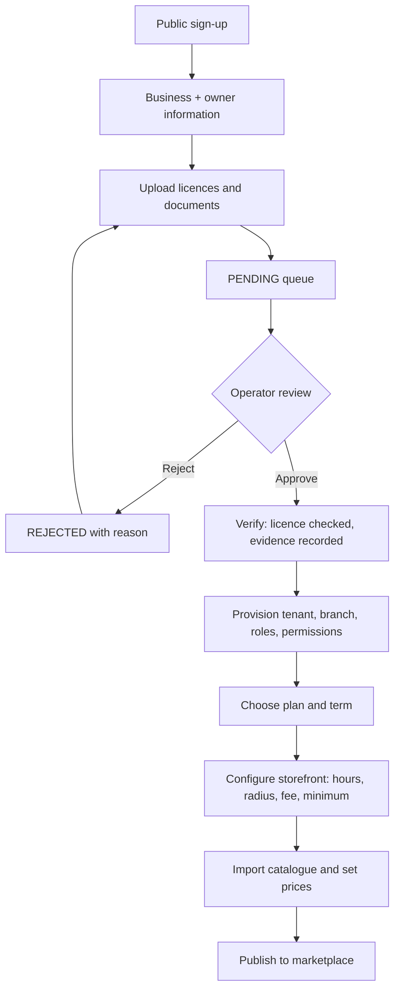

# 04 — Pharmacy Onboarding

> Friends Pharma Platform · Platform SRS v1.0 · 9 September 2026

**Status vocabulary** — EXISTS · PARTIALLY EXISTS · MISSING · NEEDS MODIFICATION · NEW PLATFORM CAPABILITY · PLANNED · RECOMMENDED · BUSINESS DECISION REQUIRED · BUSINESS / LEGAL CONFIRMATION REQUIRED. These are never mixed.

**Most of this journey already exists.** The gap is verification and storefront setup, not registration or provisioning.

| Step | Status | Detail |
|---|---|---|
| Public registration | EXISTS | POST /api/public/register — no token required. One row enters a queue; nothing is provisioned. |
| Business information | PARTIALLY EXISTS | Name, address, contact captured. No trade licence, drug licence, TIN/BIN or ownership document fields. |
| Owner information | PARTIALLY EXISTS | An owner contact exists. No national ID, no pharmacist registration number. |
| Address | PARTIALLY EXISTS | Free-text address plus an unpopulated division/district/thana/area hierarchy (1 row each). No coordinates. |
| Document upload | MISSING | File storage exists for product images, avatars and branch logos, so the mechanism is proven — but no document type, no submission, no review. |
| Verification | MISSING | Approval today is an operator's judgement in a queue. There is no verification state, no checklist, no evidence trail. |
| Approval | EXISTS | A platform operator approves with a plan, term and permission template; tenant, branch, roles and permissions are provisioned in one transaction. |
| Rejection | EXISTS | A rejected application is closed and nothing is provisioned. |
| Resubmission | MISSING | No path from rejected back to pending. |
| Subscription | EXISTS | Set at approval, with expiry and grace; the tenancy filter enforces it thereafter. |
| Activation | EXISTS | The pharmacy can trade as soon as it is provisioned. |
| Storefront configuration | MISSING | Opening hours, delivery radius, delivery fee, minimum order, logo on a storefront, published status — none exist. |
| Catalogue setup | EXISTS | Branch catalogue import from the global product master is built and in use. |

## Target journey

Solid boxes A, D, E, F, H, I and K are built today. C, G, J and L are new.

## Required information — proposed additions

| Field | Purpose | Status |
|---|---|---|
| Trade licence number and expiry | Legitimacy of the business | MISSING |
| Drug licence number and expiry | Legitimacy of dispensing | MISSING |
| Pharmacist registration number | Who may dispense | MISSING |
| TIN / BIN | Tax identity for settlement | MISSING |
| Owner national ID | Accountability | MISSING |
| Bank account for payout | Settlement | MISSING |

> Which of these are legally required, and which are merely prudent, must be confirmed with a qualified adviser. This document proposes the fields; it does not assert the obligation.
