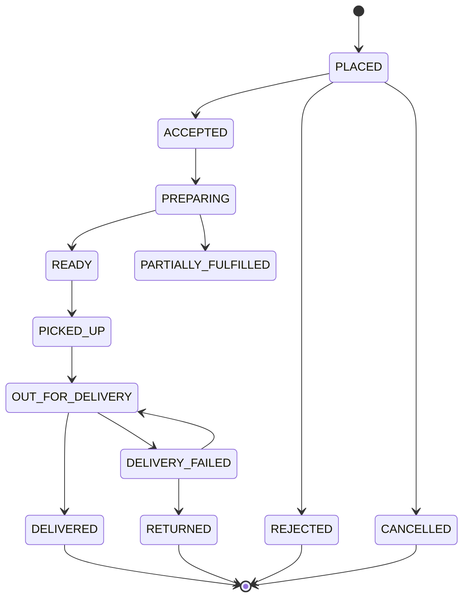

# 08 — Marketplace Order Workflow

> Friends Pharma Platform · Platform SRS v1.0 · 9 September 2026

**Status vocabulary** — EXISTS · PARTIALLY EXISTS · MISSING · NEEDS MODIFICATION · NEW PLATFORM CAPABILITY · PLANNED · RECOMMENDED · BUSINESS DECISION REQUIRED · BUSINESS / LEGAL CONFIRMATION REQUIRED. These are never mixed.

**No order object exists today.** A sale is an invoice raised by staff at a till: no acceptance, no state machine, no rejection, no partial fulfilment.

## Proposed state machine

| State | Meaning | May move to |
|---|---|---|
| PLACED | Customer has confirmed and, for prepaid, payment is authorised | ACCEPTED, REJECTED, CANCELLED |
| ACCEPTED | Pharmacy has confirmed it can fulfil | PREPARING, CANCELLED |
| PREPARING | Being picked and packed; stock reserved | READY, PARTIALLY_FULFILLED, CANCELLED |
| READY | Awaiting pickup or handover | PICKED_UP, CANCELLED |
| PICKED_UP | Courier has the order | OUT_FOR_DELIVERY |
| OUT_FOR_DELIVERY | En route to the customer | DELIVERED, DELIVERY_FAILED |
| DELIVERED | Customer has it; settlement becomes due | — (terminal) |
| REJECTED | Pharmacy declined — out of stock, closed, cannot dispense | — (terminal, refund if prepaid) |
| CANCELLED | Customer or platform cancelled | — (terminal, refund if prepaid) |
| DELIVERY_FAILED | Could not be delivered | RETURNED, OUT_FOR_DELIVERY (retry) |
| RETURNED | Back at the pharmacy; stock restored | — (terminal, refund if prepaid) |

## Edge cases that must be designed, not discovered

| Case | What it demands | Status |
|---|---|---|
| Out of stock after acceptance | The pharmacy must be able to reduce or remove a line. Partial fulfilment changes the payable amount and therefore the settlement and any refund. | PLANNED |
| Partial fulfilment | Requires an order line to carry both an ordered and a fulfilled quantity, and the money to follow the fulfilled figure. | PLANNED |
| Payment failure | A prepaid order must not reach a pharmacy until payment is authorised. | PLANNED |
| Pharmacy offline or closed | Discovery must not offer a pharmacy that cannot accept, and an order must not sit unaccepted overnight. Needs opening hours plus an acceptance timeout. | PLANNED |
| Acceptance timeout | An unaccepted order should expire rather than hang. Duration is a business decision. | BUSINESS DECISION REQUIRED |
| Delivery failure | Retry, return to pharmacy, restock, refund. Each is a decision with a money consequence. | PLANNED |
| Prescription required but not supplied | The order must be held, not rejected outright, so the customer can supply one. | BUSINESS / LEGAL CONFIRMATION REQUIRED |
| Stock reservation | Between acceptance and pickup the stock must be held, or two customers buy the same last box. The batch ledger has no reservation concept today. | PLANNED |

## Relationship to the POS sale

**Recommendation:** the order is its own aggregate, and produces a POS sales invoice at fulfilment. Overloading `POS_TRANSACTION_MST` with a marketplace lifecycle would put an eleven-state machine, acceptance, courier assignment and refunds into the same row that already carries purchases, sales and both kinds of return — a table that already requires every query to filter by type.
