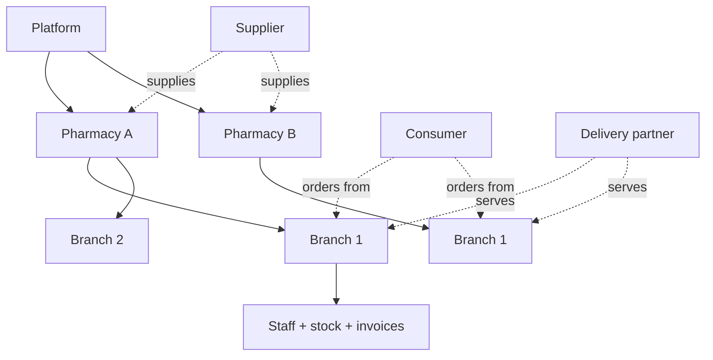

# 12 — Multi-Tenant Architecture

> Friends Pharma Platform · Platform SRS v1.0 · 9 September 2026

**Status vocabulary** — EXISTS · PARTIALLY EXISTS · MISSING · NEEDS MODIFICATION · NEW PLATFORM CAPABILITY · PLANNED · RECOMMENDED · BUSINESS DECISION REQUIRED · BUSINESS / LEGAL CONFIRMATION REQUIRED. These are never mixed.

**The existing hierarchy already matches the target.** Organisation → branch → user maps directly to pharmacy → outlet → staff. No restructuring is required.

## What exists

| Concern | Where | Behaviour |
|---|---|---|
| Organisation (tenant) | ALL_ORGANIZATION | Taken from the JWT, never the request body. A cross-tenant id returns 404, not 403. |
| Branch | ALL_BRANCH | Every screen is the session branch. Acting as another branch requires platform-operator status. |
| User | ACL_USER | Belongs to one organisation and one branch. |
| Product ownership | POS_PRODUCT_INFO per branch | Imported from the platform catalogue; priced and stocked per branch. |
| Inventory isolation | POS_STOCK_BATCH per branch | Sound. |
| Reports | Branch-scoped by default | V_SUPPLIER_ACCOUNT_BRANCH exists precisely because the organisation-grained view showed one branch the debt of all of them. |

## What the platform adds

| Concern | Status | Detail |
|---|---|---|
| Pharmacy = tenant, branch = outlet | EXISTS | The existing organisation → branch hierarchy already matches the target model. No restructuring is needed. |
| Consumer is cross-tenant | NEW PLATFORM CAPABILITY | A customer belongs to the platform, not to a pharmacy, and orders from many. This is the one genuinely new tenancy shape. |
| Order is dual-tenant | NEW PLATFORM CAPABILITY | An order belongs to a customer and to a pharmacy at once, and both must see it without seeing anything else of the other's. |
| Delivery partner is cross-tenant | NEW PLATFORM CAPABILITY | Serves many pharmacies. |
| Supplier is cross-tenant | NEW PLATFORM CAPABILITY | Serves many pharmacies; today a supplier is duplicated inside each. |
| Platform administration | EXISTS | isPlatformOperator() — role AND organisation — is already the rule and already correct. |

The dotted edges are the new shapes: participants that cross tenant boundaries. Everything solid exists today.

## The one deliberate exception

Staff isolation must not weaken. Discovery and price comparison require reading across tenants, so the recommendation is a **single narrow published-catalogue read path** — only products a pharmacy has explicitly published, only fields fit for the public, audited, and reachable by no staff endpoint. Widening the general rule instead would undo the part of this system that is most correct.
