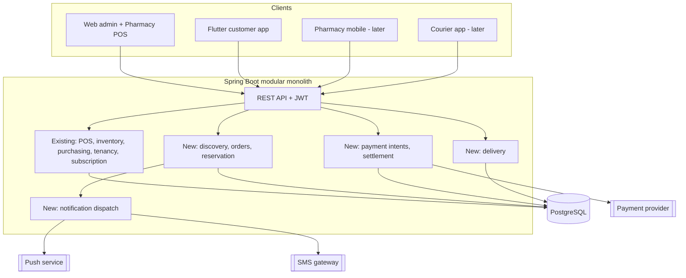

# 22 — Target Architecture

> Friends Pharma Platform · Platform SRS v1.0 · 9 September 2026

**Status vocabulary** — EXISTS · PARTIALLY EXISTS · MISSING · NEEDS MODIFICATION · NEW PLATFORM CAPABILITY · PLANNED · RECOMMENDED · BUSINESS DECISION REQUIRED · BUSINESS / LEGAL CONFIRMATION REQUIRED. These are never mixed.

## Why a modular monolith, not microservices

The brief asks not to introduce microservices without a clear reason, and there is none here. The existing system is one well-layered Spring Boot application with 297 passing tests, and its hardest correctness properties — costing, tenancy isolation, batch integrity — depend on transactions that span what would become service boundaries. Receiving stock writes a batch, a movement and an invoice atomically; splitting that costs a distributed transaction and buys nothing at this volume.

The recommendation is **modules with enforced boundaries inside one deployable**: marketplace, payment and delivery as separate packages that talk to the core through interfaces, so they *could* be extracted later if scale ever justifies it.

## The three genuinely new integrations

The backend today has **no outbound HTTP client at all**. Adding a payment provider, a push service and an SMS gateway introduces the first external dependencies in the system's life, and with them the first need for timeouts, retries, idempotency and a circuit breaker. That is an architectural change of character, not just three more clients.
