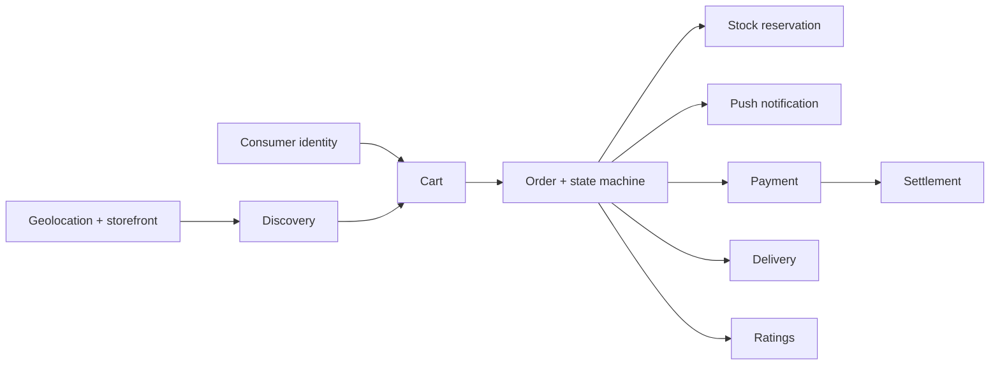

# Proposed Roadmap

**Friends Pharma Platform** · 9 September 2026

> **Proposed, not approved.** Sequencing reflects technical dependency and risk, not a commercial commitment.

## Phase 1 — Pharmacy SaaS

**Largely delivered.** POS, inventory, purchasing, branch management, subscription and the tenancy gate are built and tested.

- Close the baseline defects: dead report surface, plaintext passwords, purchase-return credit rule
- Fix the sales-discount defect before anything is built on promotions
- Add storefront profile fields and geolocation — the prerequisite for everything after

## Phase 2 — Customer marketplace

**Proposed.** The first phase that needs genuinely new domains.

- Consumer identity, addresses and app auth
- Published catalogue read path (the one designed cross-tenant exception)
- Location-based pharmacy discovery
- Cart, order, acceptance and the state machine
- Stock reservation
- Push notification for both sides
- Payment: start cash on delivery only, to defer the gateway

## Phase 3 — Delivery

**Proposed.** Deferrable — Phase 2 can launch pickup-only or pharmacy-delivered.

- Delivery partner identity and app
- Assignment
- Pickup and proof of delivery
- ETA and tracking
- Failed delivery and return

## Phase 4 — B2B commerce

**Proposed.** The existing purchasing and settlement engine is the strongest asset here.

- Supplier as a platform participant
- Wholesale catalogue, MOQ and price
- Purchase order preceding receipt
- Credit terms

## Phase 5 — Platform intelligence

**Proposed.** Only worth building on real marketplace volume.

- Platform GMV and commission reporting
- Recommendation
- Demand forecasting
- Pharmacy benchmarking

## The dependency that shapes everything

Geolocation and consumer identity gate everything. Neither is difficult; both are prerequisites, and both can start now — geolocation can be added to the branch profile during Phase 1 without waiting for the marketplace.

## Recommended first move

Add storefront fields and coordinates to the branch, and a *sell online* flag to the branch product, while Phase 1 defects are being closed. They are small, they change nothing for existing users, and they unblock the whole of Phase 2.
