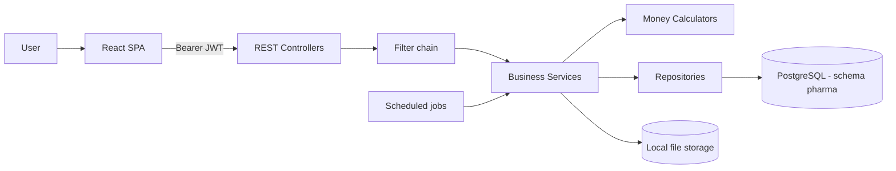

# Phase 1 — System Architecture

> Friends Pharma ERP · SRS v2.0 · 9 September 2026

## Logical architecture

## Security filter chain

The order is load-bearing: each filter depends on what the one before it established.

| # | Filter | Responsibility |
|---|---|---|
| 1 | JwtAuthenticationFilter | Establishes the principal from the Bearer token. |
| 2 | ActingBranchFilter | Resolves the branch being acted as. Only a platform operator may act as another branch. |
| 3 | TenantStatusFilter | Refuses a tenant whose subscription has lapsed, outside an open-path allow list. |
| 4 | ForcedPasswordChangeFilter | While an account holds an administrator-issued password it may reach only self-read and self-change. |

## Architectural notes

| Concern | How it is handled |
|---|---|
| Money arithmetic | Four stateless utility classes (PurchaseCalculator, SalesPriceCalculator, ProductPricingCalculator, TransactionCalculator). Pure functions, unit tested, so the create and update paths cannot drift apart. |
| Reporting | Native SQL against database views, not recomputed in Java, so a screen and its report cannot disagree. |
| Tenancy | Organisation is taken from the JWT and never from the request body. A cross-tenant identifier returns 404, not 403, so the API never confirms another organisation's record exists. |
| File storage | Local filesystem under UPLOAD_ROOT for product images, avatars and branch logos. |

## Database migration

Flyway manages the schema across 71 migrations, baselined at **V63**: no migration numbered V63 or below has ever executed against production. Tables that predate the baseline exist because they were created by hand or by Hibernate; rows those early migrations would have seeded do **not** exist. Any migration that must reach production has to be numbered V64 or above.
