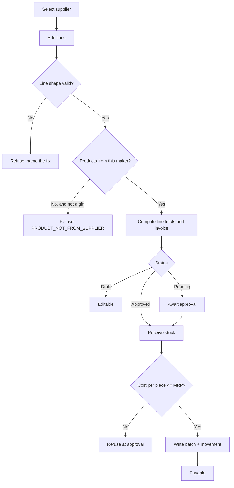
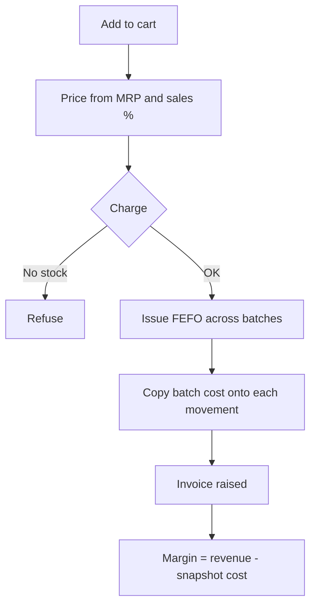
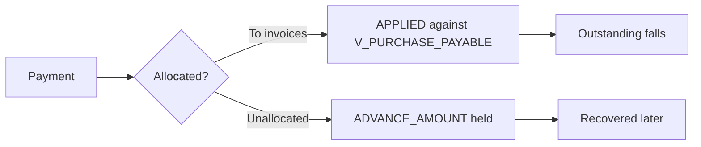
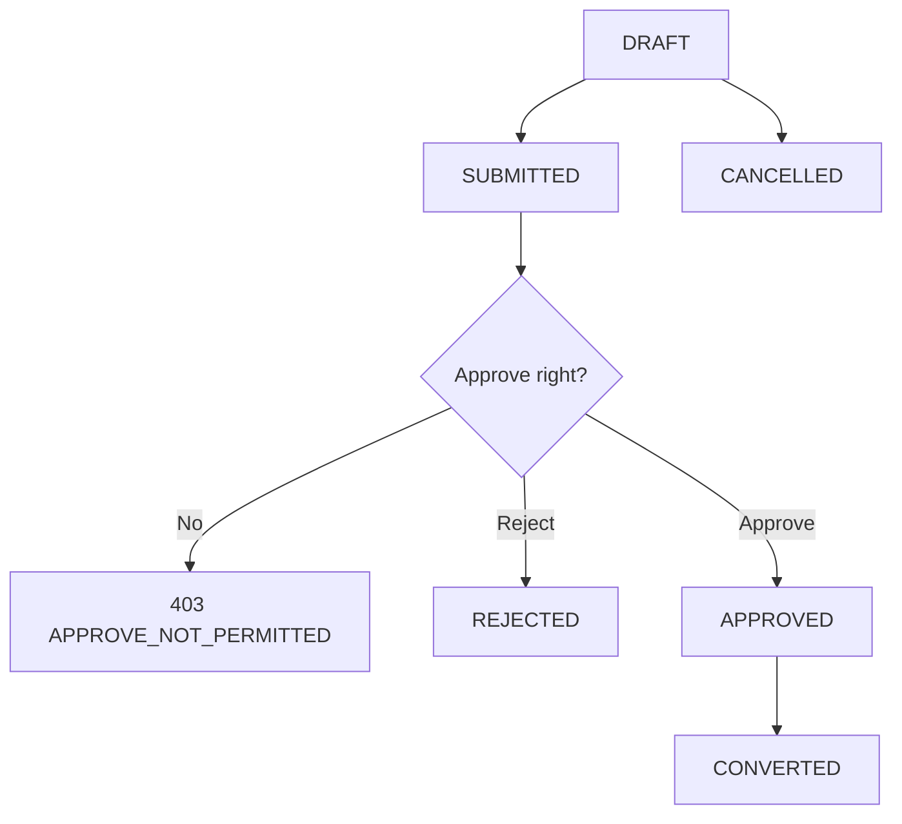
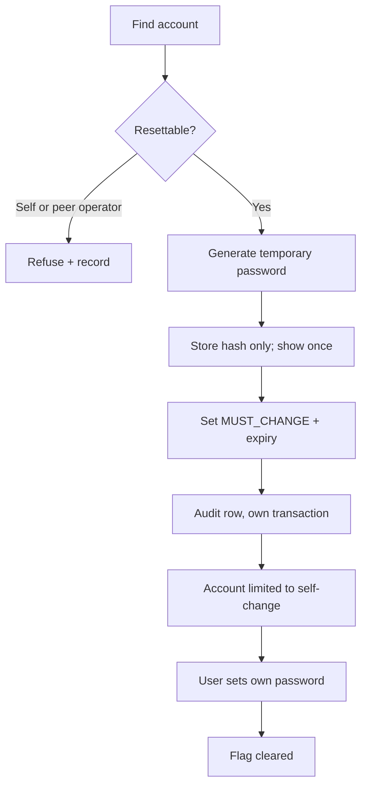
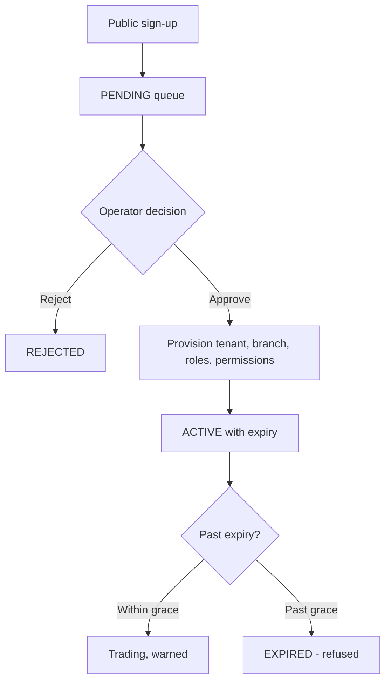

# Phase 8 — Business Workflows

> Friends Pharma ERP · SRS v2.0 · 9 September 2026

## WF-01 — Purchase to Stock

**Actors** Purchase Manager, Branch Administrator (approval)

**Trigger** A supplier invoice arrives with the goods

**Preconditions** Supplier exists and has a manufacturer assigned; products exist on the branch list

### Main flow

1. Buyer selects the supplier. Their manufacturer decides which products may be added.
2. Lines are entered — quantity, bonus, unit, TP%, discounts. A gift line carries quantity 0 and a bonus.
3. The server ignores any client-supplied price and snapshots price from the product master.
4. Line totals are computed (CALC-02 / CALC-03), then the invoice roll-up (CALC-05).
5. Saved as Draft, submitted as Pending, or created directly Approved by a user holding Approve.
6. On approval: header allocations reach the lines (CALC-06), gifts take their share (CALC-07), cost per piece is derived (CALC-08) and checked against MRP (CALC-09).
7. A batch row and an inbound movement are written; the batch carries COST_PER_PCS.
8. The invoice becomes payable and appears in V_PURCHASE_PAYABLE.

### Failure

Validation refuses with a message naming the fix. Nothing is written; the transaction rolls back.

### Postconditions

Stock on hand rises; supplier payable rises; the invoice is locked against editing.

---

## WF-02 — Sale to Margin

**Actors** Pharmacist, Sales Manager

**Trigger** A customer presents items at the counter

**Preconditions** Stock on hand exists in at least one batch

### Main flow

1. Items are added to a cart, by scan or search.
2. Unit price derives from MRP and the sales percentage (CALC-10).
3. On checkout, stock is issued FEFO — earliest expiry first.
4. Each outbound movement copies the batch's COST_PER_PCS, fixing the cost of that sale.
5. Revenue less that cost is gross profit (CALC-11).

### Failure

Insufficient stock, or no permission to sell, refuses the checkout. The cart is preserved.

### Postconditions

Stock falls; revenue and receivable rise; margin is fixed and cannot be changed by re-pricing.

---

## WF-03 — Supplier Settlement

**Actors** Accounts

**Trigger** A payment is due or a supplier is paid

**Preconditions** An approved purchase exists

### Main flow

1. Payment is recorded against one or more invoices, or held as an unallocated advance.
2. V_SUPPLIER_PAYMENT_LINE splits it into INVOICE and MANUAL sources.
3. V_PURCHASE_PAYABLE nets billed against paid and return credit (CALC-13).
4. V_SUPPLIER_ACCOUNT_BRANCH aggregates per supplier per branch.

### Failure

Overpayment beyond tolerance is refused or held as an advance.

### Postconditions

Outstanding falls; advances are carried until recovered.

---

## WF-04 — Inter-Branch Requisition

**Actors** Requesting branch, approving branch

**Trigger** A branch is short of stock another holds

**Preconditions** Both branches belong to the same organisation

### Main flow

1. A requisition is raised in DRAFT and lines are added.
2. It is SUBMITTED for approval.
3. A user holding Approve on Requisition approves or rejects it.
4. An approved requisition is CONVERTED into the movement that fulfils it.

### Failure

Rejection sets REJECTED with a reason; the stock never moves.

### Postconditions

CONVERTED requisitions are closed and cannot be edited.

---

## WF-05 — Password Reset

**Actors** Platform operator, account holder

**Trigger** A user cannot sign in

**Preconditions** The caller is ROLE01 and in the platform organisation

### Main flow

1. The operator finds the account. Credential state is shown; the password is not, and cannot be.
2. Reset is confirmed against the account's name, role and branch.
3. A 16-character temporary password is generated (CALC-15), hashed, and shown exactly once.
4. MUST_CHANGE_PASSWORD is set with an expiry; an audit row is written in its own transaction.
5. The account can then reach only self-read and self-change until it sets its own password.

### Failure

Self-reset and operator-to-operator reset are refused, and the refusal is recorded.

### Postconditions

The old password stops working immediately; the trail records who did what, when and from where.

---

## WF-06 — Tenant Onboarding

**Actors** Applicant, platform operator

**Trigger** A pharmacy applies to use the platform

**Preconditions** None — the sign-up endpoint is public

### Main flow

1. A pharmacy applies. Nothing is provisioned; one row enters a queue.
2. A platform operator reviews and approves with a plan, term and permission template.
3. Tenant, branch, roles and permissions are provisioned in one transaction.
4. The subscription sets an expiry; the tenancy filter admits or refuses on it thereafter.

### Failure

Rejection leaves the application closed and nothing provisioned.

### Postconditions

The pharmacy can trade until expiry plus grace.

